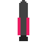
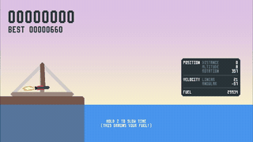
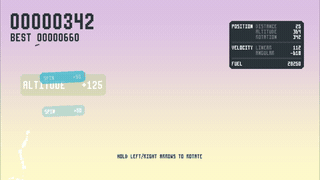
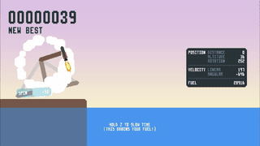
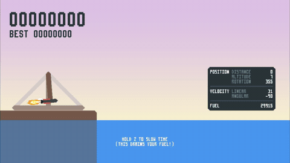

<p align="center">
  
</p>

<h1 align="center">Rocketpult Gymnasium</h1>

<p align="center">
  <strong>Swing. Launch. Stick the landing.</strong><br>
  A classic rocket-and-catapult game, built in Rust and ready for reinforcement learning.
</p>

<p align="center">
  <a href="https://www.python.org/"></a>
  <a href="https://www.rust-lang.org/"></a>
  <a href="https://gymnasium.farama.org/"></a>
  <a href="#environment"></a>
</p>

<p align="center">
  <a href="#quick-start">Quick start</a> ·
  <a href="#environment">Environment</a> ·
  <a href="#parallel-environments">Parallel environments</a> ·
  <a href="#documentation">Documentation</a> ·
  <a href="#credits">Credits</a>
</p>

<table align="center">
  <tr>
    <th align="center">🏹 Swing &amp; launch</th>
    <th align="center">🚀 Free flight</th>
    <th align="center">💨 Smoke &amp; scoring</th>
  </tr>
  <tr>
    <td align="center"></td>
    <td align="center"></td>
    <td align="center"></td>
  </tr>
</table>

<p align="center">
  <sub>Actual Rust gameplay with fixed key presses. The GIFs show the playable front end; Gymnasium exposes state vectors. <a href="docs/media/gameplay.gif">View larger gameplay ↗</a></sub>
</p>

Rocketpult turns a deceptively simple launch into a control problem: build momentum
on the catapult, choose when to release, manage fuel, and guide the rocket toward
an upright landing. The environment reuses the recreation's Box2D physics and
classic scoring behind a familiar Python `reset()` / `step()` interface.

| Feature | What you get |
| :--- | :--- |
| 🦀 **Rust physics** | Shared game rules, collisions, fuel costs and scoring from the playable recreation. |
| 🐍 **Gymnasium API** | Explicit action and observation spaces, seeded resets, rewards and episode boundaries. |
| 🖥️ **Headless execution** | Step the simulation without a browser, window, audio device or GPU. |
| 🧭 **Repeatable episodes** | A fixed virtual clock and configurable fuel initialization. |
| 🧩 **Standard wrappers** | One environment class for single-instance use, `SyncVectorEnv` and process-based `AsyncVectorEnv`. |

<a id="quick-start"></a>

## 🚀 Quick start

### 1. Install from source

You'll need **Python 3.10+**, **Rust 1.85+**, and your platform's C build tools.
From the repository root:

```sh
git clone https://github.com/Outlast18363/rocketpult-gymnasium.git
cd rocketpult-gymnasium
python3 -m venv .venv
source .venv/bin/activate
export PATH="$HOME/.cargo/bin:$PATH"
python -m pip install -e .
```

On Windows, activate the environment with `.venv\Scripts\activate` and use
`python` in place of `python3`. The `export` line is for macOS/Linux. Installation
builds the Rust extension locally; there is no published PyPI package to fetch.

### 2. Take a step

```python
import gymnasium as gym
import rocketpult_gymnasium  # registers Rocketpult-v0

env = gym.make("Rocketpult-v0")
try:
    observation, info = env.reset(seed=42)
    observation, reward, terminated, truncated, info = env.step(1)  # thrust

    print(observation.shape)  # (474,)
    print(info["score"], info["fuel"])
finally:
    env.close()
```

That's an environment I/O check: it loads no AI model and performs no training.
For readable control names, use the action helper:

```python
from rocketpult_gymnasium import RocketpultEnv

with RocketpultEnv() as env:
    observation, info = env.reset(seed=42)
    action = env.encode_action(thrust=True, turn=-1, command="release")
    observation, reward, terminated, truncated, info = env.step(action)
```

<a id="environment"></a>

## 🎮 The environment

| Property | Default |
| :--- | :--- |
| **Environment ID** | `Rocketpult-v0` |
| **Actions** | `Discrete(24)` — thrust × steering × release/leg commands |
| **Observations** | `Box(-1, 1, (474,), float32)` — rocket, catapult, platforms and episode state |
| **Reward** | Change in the original game score × `0.001` |
| **Natural episode end** | Landing or crashing → `terminated=True` |
| **Decision limit** | 1,500 steps → `truncated=True` if still active |
| **Control timing** | 4 classic simulation ticks per decision; 120 Hz virtual display clock |
| **Python rendering** | `None` or `"ansi"` text status |

Fuel, steering, spin and distance bonuses, target hits, and landing multipliers
follow the classic rules. Releasing and setting the landing legs are separate,
repeatable commands, so holding an action never toggles the legs accidentally.

Call `reset()` after either `terminated` or `truncated`. The single environment
keeps its terminal observation until you reset it. `info` contains the raw score,
score delta, success flag, outcome, fuel, position, velocity and episode clocks.

<details>
<summary><strong>🎞️ Smoke, collisions and score popups</strong></summary>

<p align="center">
  
</p>

The playable front end shares the same simulation. This second keypress demo
shows smoke and bonus effects followed by a collision; it is a gameplay example,
not a learned policy or a performance result.

</details>

<details>
<summary><strong>⚙️ Customize an episode</strong></summary>

```python
env = RocketpultEnv(
    frame_skip=4,
    reference_hz=120,
    max_episode_steps=1500,
    reward_scale=0.001,
    initial_fuel_range=(0.7, 1.0),
    allow_slow_motion=False,
    warmup_ticks=120,
)
```

The default initial state is fixed. A nonconstant `initial_fuel_range` enables
seeded fuel sampling. Override one episode with
`env.reset(seed=42, options={"fuel_fraction": 0.8})`.

Slow motion is optional; enabling it expands the action space to `Discrete(48)`.
`env.action_names` and `env.observation_names` expose the exact schemas.

See the [environment reference](docs/environment.md) for normalization scales,
action encoding, both simulation clocks, reset behavior and configuration limits.

</details>

<a id="parallel-environments"></a>

## 🧩 Parallel environments

Use Gymnasium's existing process wrapper. Each worker creates its own independent
Rust physics world; the environment needs no custom Rust worker pool.

```python
from functools import partial

from gymnasium.vector import AsyncVectorEnv
from rocketpult_gymnasium import RocketpultEnv

if __name__ == "__main__":
    envs = AsyncVectorEnv(
        [partial(RocketpultEnv) for _ in range(2)],
        context="spawn",
    )
    try:
        observations, infos = envs.reset(seed=42)
        observations, rewards, terminated, truncated, infos = envs.step([1, 1])
        print(observations.shape)  # (2, 474)
    finally:
        envs.close()
```

Run this from a Python file with the `__main__` guard. Pass environment factories
to process wrappers; each live world stays on its creating thread. See the
[parallelism notes](docs/environment.md#standard-process-parallelism) for reset
behavior and the single-process alternative.

<a id="documentation"></a>

## 📚 Documentation

| Guide | Contents |
| :--- | :--- |
| [Environment reference](docs/environment.md) | Actions, all observation groups, reward, timing, seeds and configuration. |
| [Development guide](docs/development.md) | Source map, architecture diagram, builds, tests and optional training setup. |
| [Classic game](CLASSIC_GAME.md) | Play controls and game mechanics. |
| [Rendering notes](RENDERING.md) | Original artwork, smoke, score popups and renderer parity. |
| [Media provenance](docs/media/README.md) | How the gameplay GIFs and rocket icon were made. |

### Examples

```sh
# One transition; no model loaded, no training
python examples/train_ppo.py

# Random controls; no model loaded
python examples/random_agent.py --episodes 1

# Two standard worker processes; no model loaded
python examples/vector_env.py --num-envs 2 --steps 10
```

The optional PPO example defaults to a dry run. Training requires an explicit
positive `--timesteps` argument. Optimizer/checkpoint tests are excluded from the
default test suite; details are in the [development guide](docs/development.md).

<a id="credits"></a>

## 💜 Credits

Based on **[ROCKETPULT Classic](https://parsenoire.itch.io/rocketpult)** by **parse**,
with additional art credited to **Quills**. This is an unofficial Rust recreation
with a Gymnasium adapter.

The GIFs show the recreation's playable front end. Game artwork remains credited
to its original creators; see [asset provenance](assets/reference/PROVENANCE.md).
The headless Python wheel does not require or bundle the graphical assets.
Dependencies retain their own licenses; see [third-party notices](THIRD_PARTY.md).

Project code is available under the [MIT license](LICENSE). Original artwork and
derived game media retain their original ownership. Contributions are welcome;
see [CONTRIBUTING.md](CONTRIBUTING.md).
