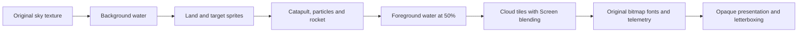

# Rendering parity with ROCKETPULT Classic

The first implementation used procedural shapes and a replacement font. The revised implementation reads the original exported sprite atlas and implements the corresponding drawing rules in Rust.

## Owning sources

- [HTML entry point](https://html-classic.itch.zone/html/565140/index.html)
- [Readable Construct runtime](https://html-classic.itch.zone/html/565140/c2runtime.js), including Sprite, Spritefont2, Particles and ScrollTo implementations.
- [Project data and event sheets](https://html-classic.itch.zone/html/565140/data.js), including sprite rectangles, origins, animations, layers, camera expressions, and interface coordinates.
- [Shared sprite atlas](https://html-classic.itch.zone/html/565140/images/shared-0-sheet0.png)
- [Cloud tiles](https://html-classic.itch.zone/html/565140/images/cloudtiles-sheet0.png)

`assets/reference/render-spec.json` records the relevant exported frame/font metadata. The exported data identifies version 1.0.1 and a logical viewport of 1920 × 1080.

## Coordinate mapping

The Rust renderer uses a 960 × 540 logical canvas, exactly half the exported viewport. It preserves the 16:9 aspect ratio and black letterboxing. Texture sampling uses nearest-neighbor filtering.

```text
original X = 2 × (Rust world X + 180)
original Y = 796 − 2 × Rust world Y
```

Rust altitude increases upward. The original screen/world Y increases downward. The original sea surface is at Y = 796.

The rocket is drawn from its 32 × 32 source frame at 64 × 64 logical pixels. Its origin is (0.625, 0.5), rather than the center of the image. Its original frame points right, so the Rust upright-heading angle is shifted by −90° for drawing. The catapult arm uses its original (4/52, 0.5) origin. The source frame's hinge-to-attachment distance becomes 88 logical pixels.

## Camera

These expressions are taken from the exported Camera event group. `rocketY` and `scrollX` below use original coordinates.

```text
targetZoom = clamp(540 / abs(540 − min(1080, rocketY)), 0.25, 1)
zoom += (targetZoom − zoom) / 8
scrollX += (rocketX − scrollX) / 8
cameraX = max(scrollX, 960 / zoom)
cameraY = min(rocketY + 270 / zoom, 1080 − 540 / zoom)
```

The exported game applies its interpolation once per rendered frame. Its Box2D step is `timescale / 60` per display frame, while fuel, particles and game timers use elapsed time. This means the original's physics runs faster on a high-refresh screen. The Rust web build now preserves that behavior to match the requested classic control feel. The macOS build reads the screen's maximum refresh rate and advances the corresponding classic ticks even when its window renderer runs at a different frequency.

## Layers and interface



Both water layers use the original blue pixel. The second pass also tints objects below the waterline. The final presentation discards intermediate alpha, matching the original opaque canvas; otherwise the half-opacity water appears incorrectly dark.

The exact original bitmap glyphs replace the initial custom font. The large font is 8 × 16 source pixels; the helper/telemetry font is 4 × 8. The telemetry artwork includes its original labels and separators. Numeric values are drawn at the image points from the exported sprite. The telemetry panel follows the rocket vertically, clamps its center between logical Y = 104 and 294, and moves horizontally between X = 800 and 480.

The sector layout now follows `CreateSector`: five platforms at fractions 1/6, 1/3, 1/2, 2/3, and 5/6 of each 5000-logical-pixel sector. Target widths are 256, 128, 64, 128 and 256; multipliers are 2, 4, 8, 4 and 2. The star markings come from the original platform sprites. The initially visible green target from the first implementation has been removed.

## Remaining differences

The launch-screen geometry, glyphs, colors, image origins and layer order now come from the export. The renderer has been visually checked against the original launch screen in the same Chrome installation.

The flight simulation now uses a Rust Box2D port with the exported collision polygons, moving catapult base, both joints, gravity, mass, force, torque, collision filtering, friction and restitution. Air damping is zero; water damping is one. Slow motion eases toward 1/16 speed; thrust and steering apply the original compensation. Steering is available without fuel and consumes none. See `assets/reference/physics-spec.json` for the inspected configuration.

Exhaust uses the original white particle sprite, size distribution, shrink rate, lifetime and speed-dependent emission. The original small lifetime-speed randomizer is included. Dark exhaust starts after fuel depletion. Explosion and splash emitters use their exported counts, size/speed ranges, growth, acceleration and gravity.

The score popups use all three original backgrounds. Bonuses below 100 use the small one-second popup, bonuses from 100 to 999 use the medium two-second popup, and bonuses of 1000 or more use the large four-second popup. Position is randomized within the original bounds; rotation is between −5° and +5°. Background scale eases from 6 to 4, then to zero. Text fades in and out over 0.125 seconds. Background opacity drops toward 25% when it covers the rocket's region.

This is still not a guarantee of identical moving frames. The export bundles an older C++ Box2D build compiled to JavaScript; the Rust port implements a newer solver. Contact resolution can therefore differ slightly. Random particles and popup placements are not seeded to the original browser's random-number sequence. Some interface transition effects and the synthesized audio differ.

The side-by-side browser check used matching ready states followed by a half-second Up Arrow hold. After matching the original frame timing, both versions ended in nearly the same catapult pose, with approximately 406–411 degrees/second angular speed and the same fuel consumption. This is a manual comparison with display-frame and screenshot timing tolerance, rather than a claim of deterministic frame identity.
