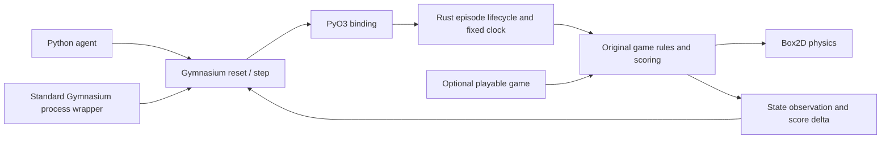

# Development guide

[← Back to the README](../README.md)

Run commands from the repository root.

## Build the Python extension

For local development, activate your Python environment and run:

```sh
python -m pip install -e .
```

Rerun that command after changing Rust code. Python source remains editable.
To build an installable wheel instead:

```sh
python -m pip install 'maturin>=1.9,<2'
maturin build --release -o dist
```

## Examples and checks

```sh
python examples/random_agent.py --episodes 3
python examples/vector_env.py --num-envs 2 --steps 100
python -m pip install 'pytest>=8,<10'
python -m pytest -q
cargo test --lib
cargo check --features play --bin rocketpult
```

An optional PPO example is in `examples/train_ppo.py`. Install
`pip install 'stable-baselines3==2.7.1'`, then run it as a Python file. This tested
version also supports saving and reloading the example's policy. It is a
training starting point; meaningful learning needs more steps and tuning.

The example defaults to a **single-transition dry run**, without loading a
training library or updating a policy. Training requires an explicit positive
`--timesteps` argument and uses one CPU thread. No training runs automatically.
The optional optimizer/checkpoint test is excluded from the default test suite;
select it explicitly with `python -m pytest -m training` when needed.

## Architecture and playable copy



- `python/rocketpult_gymnasium/env.py`: Gymnasium spaces, seeds, action helper.
- `src/python.rs`: Rust/Python binding.
- `src/environment.rs`: reset/step lifecycle, action decoding, clock, reward.
- `src/game.rs`, `src/physics.rs`: shared classic rules and physics.
- `src/main.rs`, `src/render.rs`, `src/audio.rs`: optional playable front end.

The default Rust library excludes graphics/audio dependencies. To play this
copy, use `cargo run --release --features play --bin rocketpult` or `Play.command`.
For a browser build, run `./scripts/build-web.sh`, then
`python3 scripts/serve.py` (uses port 8086; stop another game server first).
See [CLASSIC_GAME.md](../CLASSIC_GAME.md) and [RENDERING.md](../RENDERING.md)
for the recreation's history and source mapping. All code and build assets are
included in this repository; no sibling checkout is needed.

Original game concept/design/art: **parse**,
[ROCKETPULT Classic](https://parsenoire.itch.io/rocketpult), with additional art
credited to Quills. This is an unofficial recreation. The headless Python wheel
does not need or bundle graphical assets. See
[asset provenance](../assets/reference/PROVENANCE.md) and
[third-party notices](../THIRD_PARTY.md).
